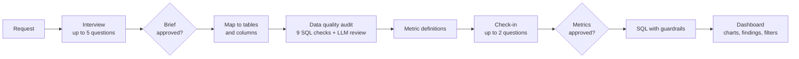

# Analyst Agent: From a Plain-English Request to an Audited Dashboard

Most dashboards go wrong before any SQL is written: the request is vague, the definitions are never agreed, and nobody checks the data. This agent works the way a business analyst does. It interviews the stakeholder, audits the data, agrees on exact metric definitions, checks in on the choices that change the numbers, and only then writes the SQL and builds the dashboard.

**[Try the live app](https://analyst-agent-melisa.streamlit.app/)**: replay three finished runs step by step, or give the agent a new request and watch it work (about 5 minutes).

## Results

Tested on 5 simulated stakeholders (each with a hidden "true need"), 25 hand-verified SQL questions, and a copy of the data with 40 planted errors.

| Test | Result |
|---|---|
| Data audit: planted errors caught | **40/40**, with **0** high-severity false alarms on the clean data |
| SQL accuracy on golden questions | **25/25** (8 easy, 9 medium, 8 hard) |
| Requirements interview, scored 1 to 5 by a separate judge model | **4.2** (up from 3.9 after prompt changes the evaluation pointed to) |
| End to end, request to dashboard | **19/19** metrics computed, every number in the findings traced to the data, **4.8 min** and **$0.46** per run |
| Check-in before building | 7 questions across 5 runs; the stakeholder overruled the agent's default on **2** |

Full write-up: [EVALUATION.md](eval/results/EVALUATION.md)

## How It Works



1. **Interview.** Asks about the decision, KPIs, period, breakdowns and units, then writes a one-page brief for approval.
2. **Audit.** Nine generic checks (duplicates, missing keys, orphan rows, date order, future dates, outliers, spelling variants and more) run as SQL. An LLM then judges which findings are real issues and proposes cleaning rules.
3. **Metric plan.** Exact definitions: numerator, denominator, which statuses count, which date column, grain, and what happens when there is nothing to divide by.
4. **Check-in.** The interview happens before the agent has seen the data, so some issues surface only now (for example, unsold products have no margin). The agent asks about the choices that change which rows appear or the headline number, with a recommended option. Minor choices are listed as "Decisions assumed" for review.
5. **SQL.** Read-only guard, dry run for cost, a 2 GB scan cap, and sanity checks on the results. Errors go back to the model, up to 2 retries.
6. **Dashboard.** The model picks the headline number from the results (it never types it), chooses the charts, and writes the findings. A grounding check rejects any number that does not appear in the data.

## Data

[theLook eCommerce](https://console.cloud.google.com/marketplace/product/bigquery-public-data/thelook-ecommerce), a public BigQuery dataset of orders, order items, products and users. A clean snapshot and a "dirty" copy with 40 planted errors of 8 types, plus an answer key, are built in `data/`.

## Tools

Python, Claude API (Sonnet as the agent, Haiku as the simulated stakeholder, Opus as the judge), Google BigQuery, pandas, Plotly, Streamlit.

## Repository Structure

```
├── agent/          # Each stage: interview, discovery, audit, metrics, SQL, dashboard, charts, filters
├── prompts/        # One prompt per stage
├── checks/         # The 9 data quality checks
├── app/            # Streamlit app: replay finished examples or run it live
├── data/           # Dataset builds, planted errors and answer key, data dictionary
└── eval/           # Personas, golden questions, evaluation scripts and results
```
